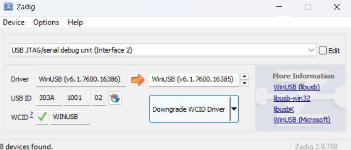
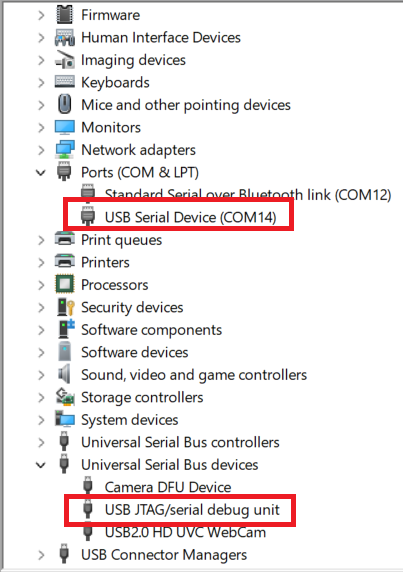
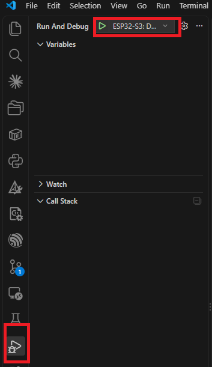
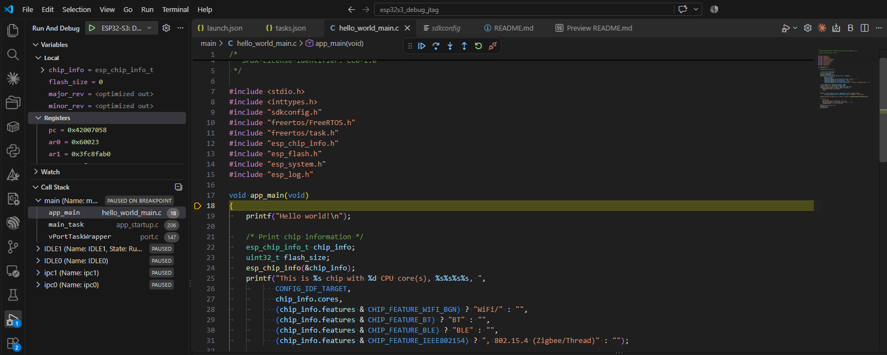

# JTAG Debugging on ESP32-S3 over Built-in USB (No UART)

This project **documents the process and steps for JTAG debugging on the ESP32-S3** using the
USB-Serial-JTAG controller built into the chip. A **single USB cable** covers all three jobs:
flashing firmware, viewing logs, and debugging — no USB-UART bridge and no external JTAG probe
(ESP-Prog, J-Link...) required.

The firmware in [main/hello_world_main.c](main/hello_world_main.c) is the ESP-IDF `hello_world`
example. It only serves as a sample program for setting breakpoints and trying out debug operations.

## Environment

| Component | Value |
| --------- | ----- |
| Chip | ESP32-S3 |
| ESP-IDF | v6.1 (`C:\esp\v6.1\esp-idf`) |
| Operating system | Windows 11 |
| IDE | VS Code + ESP-IDF extension |
| OpenOCD config | `board/esp32s3-builtin.cfg` |

## How It Works

The ESP32-S3 has a USB-Serial-JTAG peripheral hardwired to the chip's two USB pins:

| ESP32-S3 pin | USB signal |
| ------------ | ---------- |
| GPIO19 | D- |
| GPIO20 | D+ |

When plugged into a PC, this peripheral shows up as one USB device with two parts:

- **Serial port (CDC-ACM)** — appears as a COM port, used for flashing and viewing logs.
- **JTAG interface** — OpenOCD connects here for debugging.

As a result, the UART0 lines (GPIO43/GPIO44) and the on-board USB-UART chip are no longer needed.

## Steps

### 1. Hardware connection

- Plug the cable into the USB port that is **wired directly to GPIO19/GPIO20**.
- The firmware must not reconfigure GPIO19/GPIO20 for any other purpose, otherwise the USB
  connection is lost.

### 2. Install the driver on Windows

- When the USB/JTAG cable is plugged in, two entries must appear on the PC: a **COM port** and
  **USB JTAG/serial debug unit**. If they do not, the PC is missing the JTAG driver. Download
  [Zadig](https://zadig.akeo.ie/), select `USB JTAG/serial debug unit (Interface 2)` and install
  the **WinUSB** driver for it.

  

- Check in Device Manager: you should see **USB JTAG/serial debug unit** and a new COM port.

  

### 3. Console output over USB-Serial-JTAG

**No configuration is needed just to see logs.** ESP-IDF has two console channels, and on the
ESP32-S3 the default configuration already mirrors output to the USB port:

```
CONFIG_ESP_CONSOLE_UART_DEFAULT=y                # primary console: UART0
CONFIG_ESP_CONSOLE_SECONDARY_USB_SERIAL_JTAG=y   # secondary console: USB-Serial-JTAG
```

Everything written with `printf`/`ESP_LOGx` goes to UART0 and is copied to the USB port. The
secondary console has two limits:

- **Output only** — input (`scanf`, `fgets`, the `esp_console` REPL) is still read from UART0.
- **Non-blocking** — if the PC is not reading the COM port, log data is dropped instead of
  stalling the chip.

**Optional:** make USB-Serial-JTAG the primary console if you need input over USB or want to
free GPIO43/GPIO44 from UART0. In `idf.py menuconfig`:

```
Component config → ESP System Settings → Channel for console output → USB Serial/JTAG Controller
```

This is equivalent to the following line in `sdkconfig` (or in `sdkconfig.defaults` if you want
it tracked in git, since `sdkconfig` is listed in `.gitignore`):

```
CONFIG_ESP_CONSOLE_USB_SERIAL_JTAG=y
```

### 4. Build and flash the firmware

In VS Code, choose the flash method with the **ESP-IDF: Select Flash Method** command
(`UART` or `JTAG`).

```powershell
idf.py set-target esp32s3
idf.py build
idf.py -p COMx flash monitor
```

### 5. Debug

**In VS Code:** [.vscode/settings.json](.vscode/settings.json) already sets
`idf.openOcdConfigs = board/esp32s3-builtin.cfg`, and [.vscode/launch.json](.vscode/launch.json)
contains the `ESP32-S3: Debug qua USB-JTAG` configuration. It starts OpenOCD through the
`OpenOCD: start` task, attaches GDB to the chip, resets it and stops at `app_main()`.

1. Open the **Run and Debug** view, select `ESP32-S3: Debug qua USB-JTAG` and press the green
   start button (or `F5`).

   

2. The session halts on the temporary breakpoint at `app_main()`. From here you can step through
   the code and inspect local variables, CPU registers and the call stack of every FreeRTOS task.

   

## Notes

- Only one program can hold the JTAG interface at a time: stop any running OpenOCD instance
  before starting another session.

## References

- [JTAG Debugging — ESP32-S3](https://docs.espressif.com/projects/esp-idf/en/latest/esp32s3/api-guides/jtag-debugging/index.html)
- [Configure ESP32-S3 Built-in JTAG Interface](https://docs.espressif.com/projects/esp-idf/en/latest/esp32s3/api-guides/jtag-debugging/configure-builtin-jtag.html)
- [USB Serial/JTAG Controller Console](https://docs.espressif.com/projects/esp-idf/en/latest/esp32s3/api-guides/usb-serial-jtag-console.html)
